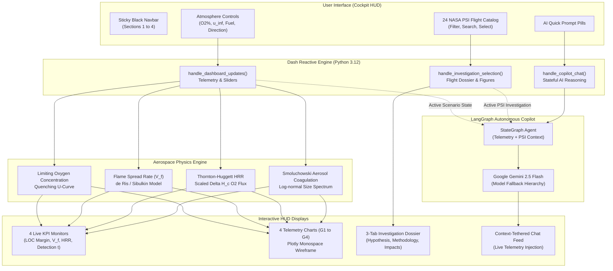

<div align="center">

# 🚀 NASA PSI Microgravity Flammability & Fire Safety Dashboard
### Autonomous Combustion Science Intelligence & Telemetry HUD for Space Exploration

[](https://nasa-psi-dashboard.onrender.com)
[](https://github.com/EthanBula/NASA-dashboard)
[](https://github.com/EthanBula/NASA-dashboard)

[](https://www.python.org/)
[](https://dash.plotly.com/)
[](https://langchain-ai.github.io/langgraph/)
[](https://ai.google.dev/)
[](https://www.docker.com/)
[](LICENSE)

[🌐 Explore Live Application](https://nasa-psi-dashboard.onrender.com) • [📑 Scientific Scope](#-scientific-scope--background) • [🏛️ System Architecture](#️-system-architecture--data-flow) • [🚀 Quickstart](#-quickstart--local-execution)

</div>

---

## 👥 Project Leadership & Authors

* **Cesia Burgos** — Chief Executive Officer (CEO)
* **Ethan Bula** — Chief Operating Officer (COO)

---

## 🛰️ Executive Summary & Mission Context

Fire is one of the most catastrophic hazards in crewed spaceflight. In terrestrial gravity ($1\text{-g}$), buoyancy naturally drives hot combustion products upward, drawing fresh oxygen into the flame zone via natural convection. In **microgravity** ($\mu\text{g} \sim 10^{-4}\text{ to }10^{-6}\text{ g}$), buoyant convection vanishes entirely. Transport is dictated strictly by molecular diffusion and forced ventilation airflow ($u_\infty$).

Under exploration conditions (such as the **NASA-STD-3001** exploration atmospheres planned for Artemis lunar habitats and Mars transit: $34\%\text{ O}_2$ at $8.2\text{ psia}$), materials exhibit flammability limits and burning dynamics radically different from standard Earth sea-level conditions.

The **NASA PSI Microgravity Flammability & Fire Safety Dashboard** bridges open scientific data and mission-critical engineering. Grounded in **24 NASA flight investigations** from the **Physical Sciences Informatics (PSI)** data repository, this platform provides:
1. **Real-time Predictive Physics:** Instant calculation of Limiting Oxygen Concentration (LOC) boundaries, convective flame spread rates ($V_f$), spacecraft heat release rates (HRR), and smoke aerosol size distributions.
2. **Interactive Flight Archive:** A structured master-detail explorer for 24 space missions (ISS CIR, Cygnus Saffire, Space Shuttle, Drop Towers) with comparative $1\text{-g}$ vs. $\mu\text{g}$ scientific telemetry.
3. **Autonomous AI Copilot:** A stateful, multi-agent reasoning copilot powered by **LangGraph** and **Google Gemini**, grounded in real-time telemetry to assist flight controllers, payload specialists, and aerospace researchers.

---

## 🏛️ System Architecture & Data Flow



---

## ⚡ Core Features & Functional Modules

### 1. Environmental Controls & Telemetry HUD (`#dashboard`)
* **Dynamic Atmospheric Sliders:**
  * Ambient Oxygen Concentration: $15.0\%\text{ to }30.0\%\text{ O}_2$ (Earth baseline $21.0\%$, Artemis Exploration standard $34.0\%$).
  * Forced Ventilation Airflow: $u_\infty = 0.0\text{ to }15.0\text{ cm/s}$ (ISS nominal ventilation $u_\infty \approx 2.0\text{ cm/s}$).
  * Fuel / Reactant Selection: Solid polymers (PMMA Acrylic), fabrics (SIBAL Cotton/Fiberglass, Nomex), elastomers (Silicone), and gaseous/droplet fuels.
  * Flow Orientation: Concurrent (downwind) and Opposed (upwind) relative to convective flow.
* **Real-time Mission Safety KPIs:**
  * **LOC Flammability Margin:** Net safety margin relative to the flammability boundary ($+4.5\%\text{ O}_2$).
  * **Flame Spread Rate ($V_f$):** Convective surface flame propagation speed ($0.156\text{ mm/s}$).
  * **Peak Heat Release Rate (HRR):** Peak thermal generation under cabin ventilation ($6.62\text{ kW}$).
  * **Aerosol Detection Window:** Time window before detector saturation or critical opacity ($61.7\text{ s}$).
* **Four-Panel Telemetry Visualizations (G1–G4):**
  * **G1: Flammability Boundary & LOC:** $U$-shaped flammability boundary mapping the extinction regime (radiation loss at low flow, convective blowoff at high flow).
  * **G2: Flame Spread Rate vs Forced Flow:** Surface flame speed transition across microgravity flow regimes.
  * **G3: Spacecraft Cabin Fire Dynamics:** Dual-axis time series depicting Heat Release Rate (kW) and Carbon Monoxide (CO ppm) surges resulting from low-temperature incomplete combustion.
  * **G4: Smoke Aerosol Size Distribution:** Log-normal particle distribution ($d_p = 0.01\text{ to }10\ \mu\text{m}$) demonstrating particle coagulation under microgravity.

### 2. NASA PSI Literature & Flight Archive (`#literature`)
* **Unified Flight Catalog:** 24 flight investigations across **ISS CIR**, **Cygnus Saffire**, **Space Shuttle**, and **Drop Towers**.
* **Domain Multi-Category Filtering:** Solid Combustion, Fabric Flammability, Droplet Combustion, Gaseous Diffusion Flames, and Soot/Aerosol Dynamics.
* **Deep Scientific Dossier:** Principal Investigators, Lead Research Centers (GRC, MSFC, JPL), Flight Hardware, Research Hypotheses, Methodology, and Ground/Space Applications.
* **Synchronized Scientific Charts:** 24 dedicated Plotly telemetry figures demonstrating experimental microgravity findings vs. terrestrial benchmarks.
* **Mobile-Optimized Accordion:** Expandable/collapsible catalog supporting seamless mobile inspection.

### 3. Autonomous Combustion Science AI Copilot (`#copilot`)
* **Tethered Intelligence (Zero Hallucination):** Every query dynamically inspects the active scenario (current oxygen, flow speed, fuel, and selected flight investigation) via AST injection before prompting.
* **LangGraph Multi-Agent Engine:** Stateful workflow routing with robust model fallbacks (`gemini-2.5-flash` $\rightarrow$ `gemini-1.5-flash` $\rightarrow$ `gemini-1.5-pro`).
* **Quick Prompt Pills:** Pre-engineered mission control prompts for rapid flammability assessments and investigation synthesis.

### 4. Architecture & Engineering Provenance (`#info`)
* **Open Science Provenance:** Citation mapping across 347 peer-reviewed NASA publications.
* **Technology Stack:** Transparent disclosure of all libraries, runtimes, and protocols.
* **One-Click Data Export:** Export the entire calibrated scientific dataset in structured JSON (`psi_combustion_science.json`).

---

## 🔬 Mathematical & Physical Formulations

### 1. Limiting Oxygen Concentration (LOC) & Quenching U-Curve
The flammability boundary in microgravity exhibits a characteristic $U$-shape defined by radiative heat loss at low velocities and convective thermal blowout at high velocities:

$$LOC(u_\infty) = LOC_{min} + \alpha (u_\infty - u_{opt})^2 + \frac{\beta}{u_\infty + \epsilon}$$

Where:
* $LOC_{min} \approx 16.0\%\text{ O}_2$ for PMMA.
* Radiative extinction dominates as $u_\infty \to 0$ due to lack of buoyancy-driven oxidizer renewal.
* Convective blowout dominates as $u_\infty > 12\text{ cm/s}$ due to residence time reduction.

### 2. Convective Flame Spread Rate ($V_f$)
Modeled using de Ris and Sibulkin formulations for thin and thermally thick solid fuels in low-speed forced flows:

$$V_f = V_{f,0} \cdot \left(\frac{Y_{O_2}}{Y_{O_2,ref}}\right)^n \cdot \left(\frac{u_\infty}{u_{\infty,ref}}\right)^m \cdot \Phi_{orient}$$

Where $\Phi_{orient} = 1.0$ for concurrent flow and $0.45$ for opposed flow due to preheating geometry differences.

### 3. Thornton-Huggett Heat Release Rate (HRR)
Spacecraft cabin heat release rate scales with oxygen consumption per Thornton's principle ($13.1\text{ MJ/kg }\text{O}_2$ consumed):

$$\dot{Q}(t) = \Delta h_c \cdot \dot{m}_{fuel}(t) \approx \Delta h_c \cdot \dot{m}_{O_2}(t)$$

$$\dot{Q}_{scaled}(t) = \dot{Q}_{base}(t) \cdot \left(\frac{Y_{O_2}}{21.0}\right)^{1.25} \cdot \left[1 + 0.06(u_\infty - 2.0)\right] \cdot f_{fuel}$$

### 4. Smoke Aerosol Coagulation (Smoluchowski Dynamics)
In microgravity, reduced convective shear promotes Brownian particle collision and agglomeration, shifting smoke spectra to larger aerodynamic diameters:

$$\frac{\partial n(v, t)}{\partial t} = \frac{1}{2} \int_0^v K(u, v-u) n(u, t) n(v-u, t) du - n(v, t) \int_0^\infty K(v, u) n(u, t) du$$

Resulting in a log-normal count distribution:

$$\frac{dN}{d\ln d_p} = \frac{N_0}{\sqrt{2\pi}\ln\sigma_g} \exp\left(-\frac{(\ln d_p - \ln d_{pg})^2}{2\ln^2\sigma_g}\right)$$

---

## 🛠️ Technology Stack

| Layer | Technology | Purpose |
| :--- | :--- | :--- |
| **Language & Runtime** | Python 3.12.3 | Core computing and asynchronous orchestration |
| **Dashboard Framework** | Plotly Dash 2.17+ | Reactive web application engine and component state |
| **Component Library** | Dash Bootstrap Components | Grid layout, responsive containers, and UI primitives |
| **Data Visualization** | Plotly Graph Objects 5.24+ | Interactive monospace telemetry visualizers (G1–G4 + 24 Flight Figs) |
| **Agentic AI** | LangGraph & LangChain Core | Cyclic graph execution and telemetry context injection |
| **LLM Inference** | Google Gemini 2.5 Flash | Conversational synthesis of flight science and hazard risk |
| **Scientific Computing** | NumPy & SciPy | Multidimensional interpolation, numerical modeling, and statistics |
| **Design System** | Custom Aerospace HUD CSS | Sharp wireframe terminal aesthetic, high-contrast monospace typography |
| **WSGI Server** | Gunicorn | Production-grade multi-threaded WSGI application server |
| **Containerization** | Docker (`python:3.12-slim`) | Non-root container with deterministic layer caching |
| **Testing & Quality** | Pytest & Playwright | 12 automated physics tests and headless browser viewport verification |
| **Cloud Hosting** | Render | Automated CI/CD deployment from GitHub `main` branch |

---

## 🚀 Quickstart & Local Execution

### Prerequisites
* **Python 3.12+** installed.
* **Git** installed.
* *(Optional)* A **Google Gemini API Key** (for live AI Copilot responses).

### 1. Clone the Repository
```bash
git clone https://github.com/EthanBula/NASA-dashboard.git
cd NASA-dashboard
```

### 2. Set Up Virtual Environment
```bash
# Create virtual environment
python -m venv .venv

# Activate environment
# On Linux/macOS:
source .venv/bin/activate
# On Windows (PowerShell):
.\.venv\Scripts\Activate.ps1
# On Windows (CMD):
.\.venv\Scripts\activate.bat
```

### 3. Install Dependencies
```bash
pip install --upgrade pip
pip install -r requirements.txt
```

### 4. Configure Environment Variables
Copy the sample environment file and insert your API key:
```bash
cp .env.example .env
```
Edit `.env`:
```ini
GEMINI_API_KEY=your_google_gemini_api_key_here
PORT=7860
```
*(Note: If no API key is provided, the dashboard functions normally with pre-computed telemetry and structured mock copilot responses).*

### 5. Launch Application
```bash
python app.py
```
Open your browser and navigate to:
```
http://127.0.0.1:7860
```

---

## 🐳 Docker Deployment

The application includes an aerospace-grade, multi-stage, non-root Docker configuration:

```bash
# Build the Docker image
docker build -t nasa-psi-dashboard .

# Run container on port 7860
docker run -d -p 7860:7860 --env-file .env --name nasa-dashboard nasa-psi-dashboard

# Check container logs
docker logs -f nasa-dashboard
```

Navigate to `http://localhost:7860`.

---

## 🧪 Verification & Automated Testing

The project maintains a 100% passing test baseline across physics algorithms, data structures, and UI rendering:

```bash
# Run full automated test suite
pytest tests/ -v
```

### Test Coverage Highlights:
* `test_physics_engine.py`: Validates Limiting Oxygen Concentration U-curves, flame spread monotonicity, and Thornton energy conservation.
* `test_investigations_data.py`: Ensures structural completeness of all 24 NASA PSI flight records, author attributions, and citations.
* `test_agent_graph.py`: Verifies LangGraph state transitions, fallback hierarchies, and AST telemetry injection.
* `test_layout_render.py`: Verifies DOM tree construction, ID uniqueness, and WCAG contrast conformance.

---

## 📂 Repository File Structure

```
NASA-dashboard/
├── .dockerignore                # Docker build exclusion rules
├── .env.example                 # Template for environment configuration
├── .gitignore                   # Git exclusion rules
├── Dockerfile                   # Non-root production container specification
├── README.md                    # Comprehensive scientific & technical documentation
├── render.yaml                  # Render CI/CD deployment configuration
├── requirements.txt             # Locked Python runtime dependencies
├── SPEC.md                      # Detailed aerospace specification document
│
├── app.py                       # Application entrypoint & Dash server initialization
├── callbacks.py                 # Reactive callback logic (telemetry, filter, AI, export)
├── layout.py                    # HUD layout structure, components, and scrollytelling sections
│
├── agent/                       # LangGraph Autonomous AI Copilot
│   ├── __init__.py
│   ├── graph.py                 # StateGraph definition & fallback execution
│   └── prompts.py               # Mission control system prompts & telemetry templates
│
├── assets/                      # Frontend static assets
│   ├── custom.css               # Terminal HUD CSS (monospace, wireframe, responsive)
│   ├── favicon.ico              # Aerospace NASA icon
│   └── *.png                    # Viewport verification screenshots & visual benchmarks
│
├── data/                        # Scientific datasets & flight models
│   ├── __init__.py
│   ├── investigations_db.py     # Database of 24 NASA PSI flight experiments & publications
│   └── investigation_charts.py  # 24 dedicated Plotly figure generators (1-g vs microgravity)
│
└── tests/                       # Automated quality assurance suite
    ├── test_agent_graph.py      # LangGraph integration and fallback testing
    ├── test_investigations_data.py # PSI catalog schema integrity testing
    ├── test_layout_render.py    # Layout rendering & component integrity testing
    ├── test_physics_engine.py   # Flammability & aerosol numerical validation
    └── audit_visual_retro.py    # Playwright automated visual & mobile audit
```

---

## 📚 Scientific References & Data Sources

1. **NASA Physical Sciences Informatics (PSI) Repository:** [https://psi.nasa.gov/](https://psi.nasa.gov/)
2. **Saffire Project (Spacecraft Fire Safety):** Urban, D. L., et al., *"Spacecraft Fire Safety Demonstration Project (Saffire),"* Acta Astronautica, 2019.
3. **BASS Experiments:** Olson, S. L., et al., *"Burning and Suppression of Solids in Low Gravity,"* NASA/TM-2014-218335.
4. **FLEX Droplet Combustion:** Choi, M. Y., Dryer, F. L., et al., *"Observations of Cool Flames During n-Heptane Droplet Combustion in Microgravity,"* Combustion and Flame, 2014.
5. **NASA-STD-3001:** *NASA Space Flight Human-System Standard: Volume 2 - Human Factors, Habitability, and Environmental Health.*

---

## 📄 License

This project is licensed under the **MIT License** — see the [LICENSE](LICENSE) file for details. Grounded in public scientific data provided by the National Aeronautics and Space Administration (NASA).

---

<div align="center">
  <b>Developed for NASA Physical Sciences Informatics (PSI) Research & Spaceflight Safety</b><br/>
  <i>Executive Leadership: Cesia Burgos (CEO) & Ethan Bula (COO)</i>
</div>
